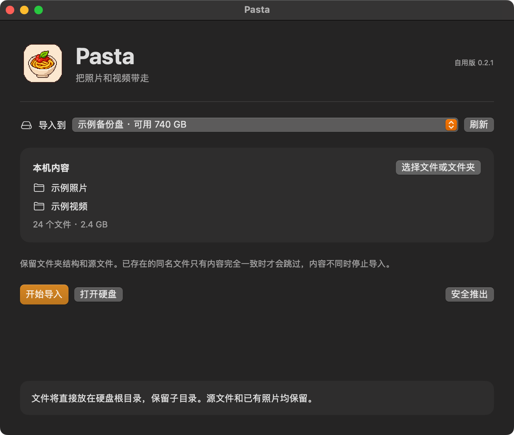

<div align="center">
  

  <h1>Pasta</h1>
  <p><strong>把照片和视频带到外置 NTFS 硬盘。</strong><br>
  选好文件和目标盘，Pasta 保留目录结构，写入后逐个读回校验。</p>

  <p><kbd>macOS 15+</kbd> &nbsp; <kbd>Apple Silicon</kbd> &nbsp; <kbd>0.2.1</kbd></p>
  <p><a href="https://github.com/C0-rrect/Pasta/releases/download/v0.2.1/Pasta-0.2.1-macOS-arm64.zip"><strong>下载 Pasta</strong></a> · <a href="#安装">安装</a> · <a href="#使用">使用</a> · <a href="https://github.com/C0-rrect/Pasta/releases/tag/v0.2.1">版本说明</a></p>
</div>

<p align="center">
  
  <br><sub>导入准备 · 示例数据。开始前可确认目标盘、文件数量和总大小。</sub>
</p>

## 功能

| 功能 | Pasta 会怎么做 |
| --- | --- |
| **批量导入** | 一次选择多个文件或文件夹，保留子目录和来源文件。 |
| **目标盘预检** | 核对分区身份、NTFS 格式、设备属性及可用空间，拒绝内部磁盘和整盘设备。 |
| **保护已有文件** | 同名文件只有内容完全一致时才跳过；内容不同时停止导入。 |
| **读回验证** | 写入后逐个读回并校验 SHA-256，完成后可在 Finder 打开硬盘或安全推出。 |

Pasta 面向外置 NTFS 盘的文件导入，无需安装 macFUSE。

## 安装

需要 **Apple Silicon Mac 和 macOS 15 或以上**。此版本在 macOS 15.8.2 上验证。

1. [下载 ZIP 安装包](https://github.com/C0-rrect/Pasta/releases/download/v0.2.1/Pasta-0.2.1-macOS-arm64.zip)，解压。
2. 把 **Pasta.app** 拖到「应用程序」，再打开。
3. 下载包使用本机临时代码签名，未经过 Apple 公证。如果 macOS 阻止启动，可以按下文从源码构建。

[发布页与 SHA-256 校验文件](https://github.com/C0-rrect/Pasta/releases/tag/v0.2.1)

## 使用

1. **连接目标硬盘。** 让外置 NTFS 分区先出现在 Finder，再在 Pasta 的「导入到」下拉框中选择它；没出现时点击「刷新」。
2. **添加来源。** 点击「选择文件或文件夹」，选好后核对文件数量、总大小和目标盘。所选内容会导入硬盘根目录，保留子目录。
3. **开始导入。** 点击「开始导入」，在 macOS 提示时批准管理员验证。硬盘会暂时从 Finder 消失；在应用报告完成前保持连接。
4. **检查结果。** 写入与校验完成后，可点击「打开硬盘」检查文件，再点击「安全推出」。

真实磁盘写入前，请保留重要文件的备份。

<details>
<summary><strong>从源码构建与验证</strong></summary>

安装 Apple Command Line Tools 与 Python 3，克隆后运行：

```sh
git clone https://github.com/C0-rrect/Pasta.git
cd Pasta
python3 build.py --clean
```

输出为 `dist/Pasta.app`。应用、管理员辅助程序、NTFS 库和预检工具均从仓库中的源码构建。

```sh
python3 Tests/compatibility_checks.py
python3 Tests/import_checks.py
```

导入测试只操作新建的 NTFS 镜像文件，覆盖中文、emoji、重名冲突和超过 4 GiB 的文件。大文件测试会临时占用较多存储空间。

NTFS-3G 的源码、作者与许可位于 `vendor/ntfs-3g-2026.9.28`。导入引擎按源码声明使用 GPL-2.0-or-later，详见 [第三方依赖与许可](THIRD_PARTY.md)。

</details>
